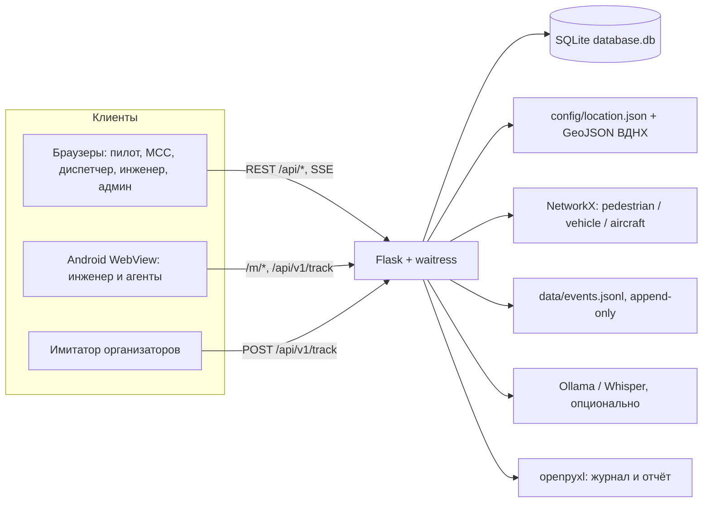

# InTrAvia

## Умная диспетчеризация инженеров на полигоне ВДНХ

Прототип для ИТ-2026. Flask + SQLite + Leaflet + Android WebView.
Цепочка заявки: пилот → MCC (ЦПУ) → диспетчер → инженер.

Тезисы к слайдам по критериям 1–22 и Д1–Д3.
Репозиторий: `Dorabotka_InTrAvia`, ветка `SlavasTest`.

---

## Слайд 1. Критерий 1. Схема архитектуры (3 б.)

- Модули: веб-интерфейсы ролей, мобильные страницы, REST/SSE, планировщик маршрутов,
  база, журнал, выгрузки, опциональные ИИ-функции.
- Стек: Python 3.13, Flask, waitress, SQLite, NetworkX, Leaflet, openpyxl.
- Связи: браузеры и WebView работают через REST; обновления приходят по SSE.
- География и правила — единый `config/location.json`, без дублей в коде.
- Схема соответствует реальному решению: те же модули запускаются `serve.py`.

---

## Слайд 2. Критерий 2. Соответствие функционала заявленному (3 б.)

Реализовано и проверяется на стенде:

- заявка пилота: борт, стоянка, дефект свободным текстом, серьёзность;
- MCC: MEL/ATA, решение о допуске, AOG-ветка, очередь ЦПУ;
- диспетчер: очередь, таблица кандидатов, назначение и переназначение;
- инженер: принять/отклонить, статусы, инструмент, маршрут, отчёт, вердикт;
- маршрут по графу ВДНХ с waypoints, спецтранспортом и ETA;
- автоматическое прибытие по GPS, норматив 15 минут, warning/breach;
- журнал событий с миллисекундами и выгрузкой XLSX;
- мобильные приложения `/m/engineer` и `/m/agents`, карта агентов у админа.

Каждый пункт этого списка демонстрируется вживую; тесты и smoke-прогон
подтверждают отсутствие регрессий.

---

## Слайд 3. Критерий 3. Процесс разработки и инструментарий (3 б.)

**Блок 1. Процесс и автоматизация**
- Итерации по этапам: цепочка ролей → графы → транспорт и ETA → мобильные
  приложения → объяснимость и запчасти → безопасность.
- Git-ветка `SlavasTest`, осмысленные коммиты, запуск `serve.py` на waitress.
- Проверки перед коммитом: `pytest`, smoke-прогон на копии БД, syntax-check
  PowerShell-скриптов.

**Блок 2. Контроль качества**
- `pytest`: 69 passed, 104 skipped (базовый аудит — 49+); покрыты авторизация, роли, цепочка,
  кандидаты, экспорт, пароли, serve, ВДНХ.
- Smoke-прогон: 29/29 проверок (заявки, принятие, движение, прибытие, журнал,
  XLSX), боевая база не меняется — работа на копии.
- Security audit: 4 критичных, 5 высоких, 5 средних, 4 низких; 15 исправлено.
  Примеры: закрыт открытый API, включён `AUTH_REQUIRED=1`, CORS сведён к
  same-origin, XSS в карточках экранирован (`escapeTaskHtml`, `escapeHtml`).
- ИИ-проверка: ассистент предлагал рефакторинг и тесты; каждое изменение
  проверялось запуском набора тестов и чтением diff человеком.

**Блок 3. Авторство**
- Людьми: постановка цепочки ролей, схема данных, сценарии диспетчера и
  инженера, решения по UX и приоритетам.
- Совместно с ИИ: проекция точек на ребро графа, три графа, таблица
  кандидатов, миграция паролей, тесты, аудит.
- ИИ: черновики шаблонов, комментарии, тексты отчётов; приняты только после
  проверки. Пример: XSS найден на ревью, исправлен вручную, закрыт тестом.

---

## Слайд 4. Критерий 4. Адаптация под полигон ВДНХ (5 б.)

- Центр полигона: `55.83367, 37.62709`; границы, дороги, объекты и зоны — в
  `static/geodata/vdnh/`, источник истины — `config/location.json`.
- Три графа NetworkX:
  - пешеходный: 431 узел, 459 рёбер (`service` + `pedestrian`);
  - транспортный: 332 узла, 348 рёбер (`service`);
  - авиационный: 351 узел, 379 рёбер (`taxi` + `runway`).
- 10 стоянок ВС `SZ-1..SZ-10`, 6 объектов (терминал, склады, парковка
  спецтехники и др.), 325 дорожных сегментов.
- Скорости рёбер: 5/8/10/20 км/ч по типам участков; вес ребра — время.
- Стартовые позиции: инженеры — Терминал, машины — стоянка спецтехники
  (`tools/apply_vdnh_location.py`, идемпотентно, с резервной копией БД).
- Карты Leaflet: граница полигона, дороги, зоны стоянок, объекты и агенты.

---

## Слайд 5. Критерий 5. Маршрутизация (5 б.)

- Маршрут строится по явному графу дорог, а не по прямой: NetworkX,
  кратчайший путь по времени.
- Для инженера запрещены рулёжки и ВПП: используется пешеходный граф,
  авиационный — только для ВС.
- Учитываются правила движения и типы дорог; скорость ребра берётся из
  `spd_kmh`, а не из постоянной величины.
- Стоянки ВС — полигоны `SZ-N`; старые числовые id поддержаны как алиасы.
- Ответ `/api/route` содержит `path`, `legs`, `distance_m`, `time_s`,
  `eta_min`, `warnings`.

---

## Слайд 6. Критерий 6. Маршруты с промежуточными точками (4 б.)

- `POST /api/route` принимает `waypoints: [{lat, lng}, ...]`.
- Поддержано 1 и более промежуточных точек; каждая добавляет задержку
  `warehouse_s = 30` секунд (получение инструмента).
- Типовой сценарий: инженер → склад за инструментом → парковка спецтехники →
  борт `SZ-N`.
- Пересадка на спецтранспорт: пеший участок до машины, затем транспортный
  граф; посадка и высадка — по 10 секунд.
- В ответе видно разбиение на `legs` с режимом `walk` / `transport` и временем
  каждого участка.

---

## Слайд 7. Критерий 7. Точки за пределами графа дорог (1 б.)

- Точка проецируется на ближайшее допустимое ребро графа.
- Маршрут строится от реальной позиции агента до ребра и далее по графу.
- Работает и для старта вне дороги, и для цели вне дороги (стоянка в стороне).
- В ответе есть `warnings`: «Старт в N м от дороги», «Цель в N м от дороги».
- Проекция не подменяет геометрию: предупреждение показывается диспетчеру и
  попадает в маршрутный ответ.

---

## Слайд 8. Критерий 8. Обновление маршрута по мере продвижения (3 б.)

- Каждая новая GPS-точка инженера запускает пересчёт активного маршрута.
- Пересчёт фиксируется событиями `route_recalculated` и `eta_updated` с
  временем выполнения в миллисекундах.
- ETA пересчитывается по фактическому положению, а не остаётся статичным.
- Маршрут-превью появляется сразу после назначения, но движение и таймер
  стартуют только после принятия заявки инженером.
- Обновления уходят в браузер и мобильное приложение по SSE.

---

## Слайд 9. Критерий 9. Применение спецтранспорта (5 б.)

- Система решает, нужен ли транспорт, а не назначает его всегда.
- Сравниваются два варианта: пешком и с пересадкой на машину.
- Учитываются посадка и высадка по 10 секунд, пеший участок до машины и
  время движения по транспортному графу.
- Выбирается вариант с меньшим временем; в ответе — `using_car`, `best_car`,
  `walk_to_car`, `car_time`.
- Если машина не даёт выигрыша, инженер идёт пешком; это видно в таблице
  кандидатов и в карточке заявки.

---

## Слайд 10. Критерий 10. Интерфейс инженера (5 б.)

- Приём и отклонение заявки; отклонение возвращает заявку в очередь или
  передаёт другому инженеру.
- Смена статуса: принял, в машине, прибыл, диагностика, отчёт.
- Маршрут на карте Leaflet: линия, участки, цель, позиция инженера.
- Статус инструмента: «Есть», «Нет», «На складе»; при «На складе» строится
  маршрут через склад.
- Текущая позиция и ETA по заявке; интерфейс адаптирован под мобильный
  WebView (`/m/engineer`).

---

## Слайд 11. Критерий 11. Работа интерфейса в полевых условиях (5 б.)

- Позиция живого инженера отображается на карте в реальном времени (GPS +
  SSE).
- Заявка доводится до статуса «Выполнено» через отчёт инженера.
- Прибытие фиксируется автоматически: точка внутри полигона стоянки ВС
  переводит задачу в `arrived`.
- В событии `arrival` есть время с назначения, ETA, отклонение и признак
  нарушения норматива.
- Факт прибытия, выполнения или нарушения записан в журнал и доступен в
  XLSX-выгрузке.

---

## Слайд 12. Критерий 12. Приём геопозиции (5 б.)

- Приём координат из интерфейса инженера и от внешних агентов.
- `POST /api/v1/track`: одиночная точка или пакет `{"points": [...]}`.
- Контракт: `obj`, `lat`, `lon`, `t`, `acc`, `spd`; поддержаны `e-01`,
  `EN-001`, `CAR-001`, регистрация ВС.
- Ответ: `accepted`, `applied`, `obj`, `t`; `400` при отсутствии или
  нечисловых `lat`/`lon`; `200` + `applied:false` для неизвестного объекта.
- Единый путь приёма, валидации и привязки к графу для всех источников.
- Ошибки приёма пишутся в `data/ingest_errors.log` и журнал событий.

---

## Слайд 13. Критерий 13. Штатная цепочка передачи заявки (5 б.)

- Цепочка: пилот → MCC/ЦПУ → начальник смены (диспетчер) → инженер.
- Пилот не может назначить заявку конкретному инженеру: назначение делает
  только диспетчер.
- Каждое звено отражено в интерфейсе и в `routing_history`.
- Переходы: `pilot` → `mcc` → `dispatcher` → `technician`; текущий этап
  виден в очереди и карточке.
- Действия вне роли блокируются серверной матрицей прав и возвращают `403`.

---

## Слайд 14. Критерий 14. Права и полномочия ролей (5 б.)

- Инженер: диагностика, устранение, проверка MEL из ATLB, вердикт
  AOG / MEL / «Устранено», категория MEL A/B/C/D и срок.
- Начальник смены: назначение, переназначение, снятие с заявки после
  «В работе» — только с подтверждением (`confirmed_by`).
- AOG и MEL-категорию выставляет инженер при отчёте, а не пилот, диспетчер
  или автоматика; MCC подтверждает решение.
- Матрица `WRITE_ENDPOINT_ROLES` проверяет путь и метод; чужой инженер
  получает `403`.
- Администратор обходит матрицу, но его действия также попадают в журнал.

---

## Слайд 15. Критерий 15. Статусная модель работ (5 б.)

- Цепочка: замечание экипажа → не назначено → назначено → в работе →
  выполнено.
- Дополнительные состояния: `arriving`, `in_car`, `arrived`, `diagnosing`,
  `awaiting_parts`, `report_submitted`.
- Переходы валидируются: нельзя произвольно перескочить или откатить статус.
- Снятие после «В работе» — только через `unassign` с подтверждением
  старшего смены.
- Каждое изменение пишется в `routing_history` и событие `status_changed` с
  участником и временем.

---

## Слайд 16. Критерий 16. Многокритериальный подбор исполнителя (5 б.)

- Учитывается срочность: `severity` задаёт множитель в оценке.
- Учитывается местоположение и время прибытия: пешком и на спецтранспорте.
- Учитывается квалификация: глава ATA / профиль дефекта → требуемый навык
  (`engine`, `avionics`, `hydraulics`, `electrical`, `mechanical`, `general`).
- Учитывается загрузка за смену и занятость.
- Инженер, уже начавший работу, не снимается автоматически.
- Оценка `score = travel_time × urgency + workload × 2 + бонус за машину`;
  выбирается лучший по совокупности, а не «первый свободный».

---

## Слайд 17. Критерий 17. Объяснимость назначения (5 б.)

- Таблица кандидатов: допуск, занятость, время пешком/на транспорте,
  загрузка, срочность, итоговая оценка.
- Для каждого кандидата есть `eligible` и `reason`.
- Причины отказа: занят, работает по другой заявке, нет допуска, нет
  координат, не успевает в 15 минут, уже отказался.
- Видно основание выбора назначенного: допуск, время, машина, загрузка.
- `GET /api/dispatcher/candidates/<rid>` отдаёт таблицу и `duration_ms`;
  событие `candidates_built` фиксирует время построения.

---

## Слайд 18. Критерий 18. Открытый классификатор неисправностей (5 б.)

- Ввод дефекта свободным текстом; формулировка сохраняется как есть.
- Поиск по существующим категориям, синонимам и главам ATA.
- Неизвестный текст не теряется: создаётся запись `custom_<hash>` в каталоге
  неисправностей, без доработки кода.
- Поддержаны несколько источников заявок: пилот, диспетчер, голосовая
  заявка (Whisper), импорт.
- Классификатор расширяемый: новые типы добавляются данными, а не правкой
  логики.

---

## Слайд 19. Критерий 19. Несколько срочных заявок и AOG (5 б.)

- Несколько заявок и AOG обрабатываются параллельно; очередь диспетчера
  видна отдельно.
- Инженер не снимается автоматически с начатого ремонта.
- Ожидание запчастей: `awaiting_parts` держит заявку с отметкой, инженер
  возвращается в пул.
- Получение запчастей: `parts_received` возвращает заявку в очередь.
- Смена исполнителя — через `unassign`; после «В работе» требуется
  подтверждение старшего смены.
- Все переходы и причины фиксируются в журнале.

---

## Слайд 20. Критерий 20. Расчёт и контроль норматива 15 минут (5 б.)

- Норматив `REGULATION_MINUTES = 15`; таймер стартует с фиксации назначения
  (`inspection_assigned_at`).
- ETA прогнозируется заранее по графу, а не констатируется постфактум.
- Прогноз учитывает скорости участков, пересадку на спецтранспорт
  (посадка/высадка 10 с) и получение инструмента (30 с на waypoint).
- ETA обновляется по GPS; события `eta_updated` и `route_recalculated`
  показывают динамику.
- Прибытие — по попаданию в полигон стоянки ВС; в событии `arrival` есть
  `elapsed_min`, `eta_min`, `delta_min`, `late`.
- В журнале есть и создание заявки, и назначение, поэтому полное время от
  фиксации заявки тоже видно.

---

## Слайд 21. Критерий 21. Упреждающее оповещение о риске (5 б.)

- Warning появляется за 5 минут до норматива (`remaining_min <= 5`).
- Адресат — диспетчер/начальник смены: событие `warning` уходит в SSE и
  журнал.
- В полезной нагрузке есть `remaining_min`, `eta_min`, ближайший свободный
  инженер и флаг `can_make_it`.
- Предлагается вариант решения: кто ещё успевает и с каким запасом.
- После истечения норматива фиксируется отдельное событие `breach`.
- Повторные warning/breach не дублируются: проверка по `routing_history`.

---

## Слайд 22. Критерий 22. Журнал событий (5 б.)

- Append-only JSONL `data/events.jsonl`; записи не перезаписываются.
- Фиксируются: создание заявки, кандидаты и время их построения,
  назначение, статусы, переназначения, маршруты и пересчёты, ETA, прибытие,
  warning, breach, ошибки приёма, отказы по ролям.
- Метки времени — ISO 8601 с миллисекундами.
- Одна строка — одно событие; есть `type`, участники и параметры.
- Выгрузка XLSX: `/api/v1/events/export.xlsx` и общий отчёт
  `/api/reports/export.xlsx` (лист «Журнал»).
- Журнал согласуется с фактами прогона: smoke-скрипт проверяет наличие
  `arrival` и выгрузок.

---

## Слайд 23. Критерий Д1. Дополнительные сведения о маршруте (4 б.)

- Маршрут обновляется по мере продвижения (см. критерий 8).
- В ответе есть `legs`: участки, режим, расстояние, время, скорость.
- В карточке инженера видны время пешком, время на транспорте, ETA и точка
  прибытия.
- Диспетчер получает предупреждения о риске и рассогласовании данных
  (`warning`, `breach`).
- Задел: текстовые подсказки по поворотам и озвучивание через Web Speech API
  на основе `legs`; базовая геометрия и времена для этого уже есть.

---

## Слайд 24. Критерий Д2. Нестабильная связь и потеря GPS (5 б.)

- Мобильный инженер хранит очередь GPS-точек в `localStorage` и досылает её
  автоматически при восстановлении связи (`navigator.onLine`).
- Последняя точка переживает перезагрузку страницы; недоставленная точка
  повторяется.
- Сервер хранит последнюю позицию с `updated_at`; устаревшие позиции
  очищаются `prune_stale_map_positions`.
- После восстановления связи маршрут и ETA пересчитываются по новым точкам.
- Ошибки приёма не теряются: `data/ingest_errors.log` и событие
  `ingest_error`.

---

## Слайд 25. Критерий Д3. Оригинальность и инженерная мысль (2 б.)

- Три специализированных графа вместо одной дорожной сети: пешеходный,
  транспортный, авиационный.
- Объяснимое назначение: не только «кто выбран», но и «почему остальные
  нет», с временем построения таблицы.
- Сравнение «пешком vs спецтранспорт» с посадкой/высадкой и выбором по
  времени.
- Инструмент «на складе» автоматически строит маршрут через склад.
- Автоматическое прибытие по геозоне и контроль норматива 15 минут.
- Жизненный цикл «ожидание запчастей» с освобождением инженера и
  подтверждением снятия.
- Всё это не ломает базовую цепочку: pytest 69 passed, smoke 29/29.

---

## Слайд 26. Развёртывание и демонстрация

- Локально: `.venv\Scripts\python.exe serve.py` (waitress, порт 8080).
- Публично: `powershell -ExecutionPolicy Bypass -File tools\start_public.ps1`
  (waitress на 5000 + Cloudflare Quick Tunnel, `GODEBUG=http2client=0`).
- Остановка: `tools\stop_public.ps1`; PID-файл `logs/public_pids.txt`.
- Ограничения quick tunnel: URL меняется, нет гарантии uptime; для сдачи —
  named tunnel или VPS с Caddy/nginx.
- Перед публикацией сменить демо-пароли:
  `tools/rotate_demo_passwords.py --email ...` (пароль не выводится).
- Проверки: `pytest` — 69 passed, 104 skipped; smoke — 29/29.
