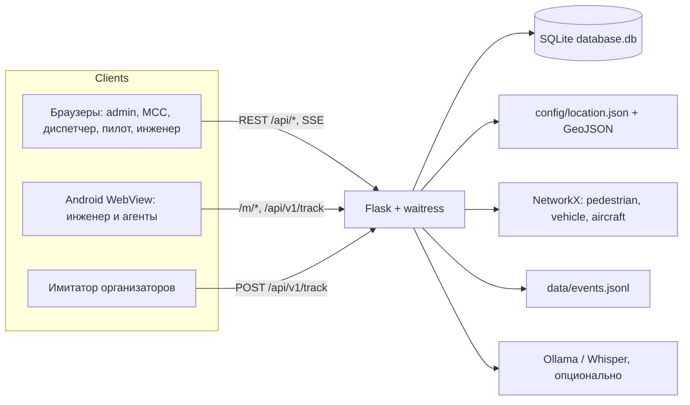

# InTrAvia — умная диспетчеризация инженеров на полигоне ВДНХ

Прототип для ИТ-2026: Flask + SQLite + Leaflet + Android WebView. Цепочка
заявки — **пилот → MCC (ЦПУ) → диспетчер → инженер**. Маршруты строятся по
трём дорожным графам ВДНХ, спецтранспорт выбирается сравнением времени,
прибытие в сервисную зону фиксируется автоматически по GPS.

## Быстрый запуск

```powershell
# 1. Зависимости (Python 3.13+)
python -m venv .venv
.venv\Scripts\pip install -r requirements.txt

# 2. База: положить database.db рядом с app.py (сервер не создаёт её сам)

# 3. Секреты
copy .env.example .env
# в .env задать SECRET_KEY:
# python -c "import secrets; print(secrets.token_hex(32))"

# 4. Запуск
.venv\Scripts\python.exe serve.py        # waitress, http://127.0.0.1:8080
.venv\Scripts\python.exe app.py          # dev-сервер, http://127.0.0.1:5000
```

Вход: `/login.html`. Учётные записи и роли выдаёт администратор
(`/admin/dashboard.html`). Демо-пароли не публикуются в репозитории.

### Переменные окружения

| Переменная | По умолчанию | Назначение |
|---|---|---|
| `SECRET_KEY` | случайный | подпись cookie сессии |
| `APP_PORT` | `8080` | порт waitress |
| `AUTH_REQUIRED` | `1` | серверная авторизация; `0` — демо-стенд |
| `CORS_ORIGINS` | пусто | список origin через запятую; пусто — same-origin |
| `SESSION_COOKIE_SECURE` | `0` | `1` при работе по HTTPS |
| `INTRAVIA_DB` | `database.db` | путь к БД (тесты и стенды) |
| `INTRAVIA_EVENTS` | `data/events.jsonl` | журнал событий |
| `LLM_ENABLED`, `LLM_MODEL` | `1`, `qwen2.5:3b` | Ollama для подсказок |
| `WHISPER_MODEL` | `small` | распознавание голосовых заявок |

## Полигон ВДНХ

- Центр: `55.83367, 37.62709`; границы, дороги, объекты и зоны — в
  `static/geodata/vdnh/`, единственный источник географии —
  `config/location.json`.
- Три графа NetworkX: пешеходный (`service` + `pedestrian`), транспортный
  (`service`), авиационный (`taxi` + `runway`). Вес ребра — время в секундах
  по `spd_kmh`.
- Стартовые позиции: инженеры — Терминал, машины — Стоянка спецтехники
  (`tools/apply_vdnh_location.py`, идемпотентно, с резервной копией БД).
- Стоянки ВС — `SZ-1..SZ-10`; старые числовые id поддерживаются как алиасы.

## Роли

| Роль | Что делает |
|---|---|
| `pilot` | создаёт заявку о дефекте, видит свои заявки |
| `mcc` | MEL/ATA, решение о допуске, очередь ЦПУ (объединена с MCC) |
| `dispatcher` | принимает заявку из MCC, назначает/переназначает инженера |
| `engineer` | принимает/отклоняет, едет, диагностирует, отправляет отчёт |
| `admin` | пользователи, импорт, очистка, выгрузки |

Роль `cpu` удалена: ЦПУ — это тот же MCC, отдельная учётная запись не нужна.

## Мобильные приложения

- Страницы: `/m/engineer` (инженер) и `/m/agents` (ввод данных любых агентов).
- Маяк: выбранный агент + интервал + GPS или точка на карте; для
  спецтранспорта и ВС — пакетная отправка по 5 точек.
- Экранирование данных, SSE-обновления без перезагрузки, вход по сессии.
- Android-оболочки: `mobile/webview-engineer`, `mobile/webview-agents`.

```bash
cd mobile/webview-engineer
export JAVA_HOME="/c/Program Files/Android/Android Studio/jbr"
export ANDROID_HOME="C:\\Users\\<user>\\AppData\\Local\\Android\\Sdk"
./gradlew assembleDebug --no-daemon
# то же для mobile/webview-agents
```

APK: `app/build/outputs/apk/debug/app-debug.apk`. В приложении задаётся адрес
сервера (без `/m/...`), затем вход по email и паролю.

## API

| Метод | Путь | Назначение |
|---|---|---|
| POST | `/api/v1/track` | точка или `{"points": [...]}`; `obj/lat/lon/t/acc/spd` |
| GET | `/api/v1/stream` | SSE: `hello`, `position`, `sync`, `warning`, `arrival` |
| GET | `/api/v1/agents` | текущие позиции агентов |
| GET | `/api/v1/snapshot` | агенты + активные заявки |
| GET | `/api/location` | конфиг ВДНХ, объекты, зоны, дороги, граница |
| GET | `/api/parking` | стоянки `SZ-N` с полигонами |
| POST | `/api/route` | `agent_type`, `start`, `waypoints`, `target`, `use_transport` |
| GET | `/api/v1/events?since=` | журнал событий (MCC/диспетчер/админ) |
| GET | `/api/v1/events/export.xlsx` | выгрузка журнала |
| GET | `/api/reports/export.xlsx` | общий отчёт, лист «Журнал» |

`POST /api/v1/track` и SSE остаются публичными по контракту организаторов;
остальные API закрыты сессией.

## Архитектура



## Тесты и проверка

```powershell
.venv\Scripts\python.exe -m pytest -q          # 48 passed, 104 skipped
.venv\Scripts\python.exe tools/smoke_vdnh.py   # 3 заявки, прибытия, журнал, XLSX
.venv\Scripts\python.exe tools/build_location_config.py
.venv\Scripts\python.exe tools/apply_vdnh_location.py
```

## Безопасность

- `AUTH_REQUIRED=1` по умолчанию, cookie `HttpOnly` + `SameSite=Lax`.
- Пароли — scrypt (werkzeug), старые открытые пароли мигрируются при входе.
- Security-заголовки, same-origin CORS, rate limit входа, санитизация 500.
- `database.db` в репозиторий не входит: восстановите из резервной копии.
- Полный отчёт и остаточные риски — `SECURITY_AUDIT.md`.

## Презентация: тезисы

1. **Архитектура и стек.** Схема выше: браузеры и WebView → REST/SSE →
   Flask/waitress → SQLite + GeoJSON + графы NetworkX + JSONL-журнал;
   опционально Ollama/Whisper.
2. **Функционал.** Заявка от пилота, MEL/ATA в MCC, назначение диспетчером,
   маршрут по графу с waypoints и спецтранспортом, ETA, автофиксация
   прибытия, норматив 15 минут, журнал и XLSX, мобильные приложения.
3. **Разработка и качество.** Итерации по этапам, pytest (48 тестов),
   smoke-скрипт на копии БД, ревью безопасности, ИИ-ассистент для
   рефакторинга и тестов; найденные XSS и открытый API исправлены.
4. **Авторство.** Людьми: постановка цепочки ролей, схема данных, интерфейсы
   диспетчера и инженера. Совместно с ИИ: роутер с проекцией на ребро,
   три графа, миграция паролей, тесты, аудит. ИИ: черновики шаблонов,
   комментарии и отчёты; все изменения проверялись запуском тестов.
5. **Адаптация под ВДНХ.** Конфиг локации, 325 дорог, 10 зон, 6 объектов,
   карты Leaflet с границей и слоями, стартовые позиции агентов.
6. **Маршруты, транспорт, ETA, журнал.** Скорости рёбер, запрет рулёжек для
   инженера, выбор машины сравнением времени, пересчёт ETA по GPS,
   warning за 5 минут, breach и факт прибытия в `events.jsonl`.

---

# Приложение. Чеклист финального этапа «Ит-2026»

**Максимум: 108 баллов** = обязательная часть (22 критерия, 97 б.) + необязательная часть (3 критерия, 11 б.)
**Полигон:** ВДНХ, Москва. **Испытание:** 1 попытка, 3 части (презентация + имитация + живой инженер).

---

## 0. Организационные требования (без баллов, но без них не допустят)

- [ ] Адрес развёрнутого решения сообщён организаторам до испытаний
- [ ] Решение доступно по сети Интернет (удалённый сервер или рабочая машина команды)
- [ ] Проверка готовности пройдена; **после неё нельзя менять код, конфигурацию и дорожный граф**
- [ ] Интерфейс инженера подготовлен для полевого инженера-организатора (вход + размещение на точке за первые 5 минут)
- [ ] Есть возможность создания заявок в решении (для финальных испытаний)
- [ ] Презентация (PDF/PPTX/JPEG/PNG): схема архитектуры, реализованный функционал, процесс разработки и инструментарий
- [ ] Ссылка на репозиторий исходного кода + открытая среда разработки на защите

---

## 1. Сводная таблица (заполняйте по ходу самопроверки)

| № | Критерий | Макс | Ставлю | Факт |
|---|----------|------|--------|------|
| 1 | Схема архитектуры | 3 | | |
| 2 | Соответствие функционала заявленному | 3 | | |
| 3 | Процесс разработки и инструментарий | 3 | | |
| 4 | Адаптация под полигон | 5 | | |
| 5 | Маршрутизация | 5 | | |
| 6 | Промежуточные точки | 4 | | |
| 7 | Точки вне графа дорог | 1 | | |
| 8 | Обновление маршрута | 3 | | |
| 9 | Применение спецтранспорта | 5 | | |
| 10 | Интерфейс инженера | 5 | | |
| 11 | Работа в полевых условиях | 5 | | |
| 12 | Приём геопозиции | 5 | | |
| 13 | Штатная цепочка заявки | 5 | | |
| 14 | Права и полномочия ролей | 5 | | |
| 15 | Статусная модель работ | 5 | | |
| 16 | Многокритериальный подбор | 5 | | |
| 17 | Объяснимость назначения | 5 | | |
| 18 | Открытый классификатор неисправностей | 5 | | |
| 19 | Несколько срочных заявок и AOG | 5 | | |
| 20 | Расчёт и контроль норматива 15 мин | 5 | | |
| 21 | Упреждающее оповещение о риске | 5 | | |
| 22 | Журнал событий | 5 | | |
| Д1 | Доп. сведения о маршруте | 4 | | |
| Д2 | Нестабильная связь и потеря GPS | 5 | | |
| Д3 | Оригинальность и инженерная мысль | 2 | | |
| | **ИТОГО** | **108** | | |

---

## 6.1. Обязательная часть (97 баллов)

### 1. Схема архитектуры — 3 б.
- [ ] Показаны основные модули системы
- [ ] Показаны связи между модулями
- [ ] Указан технологический стек каждого модуля
- [ ] Схема соответствует реальному решению
> 3 б. — модули + связи + стек; 2 б. — без стека; 1 б. — только модули.

### 2. Соответствие функционала заявленному — 3 б.
- [ ] Есть явный список реализованного функционала в презентации
- [ ] Каждый пункт списка реально работает на испытаниях без ошибок
> 3 б. — всё совпадает; 2 б. — часть работает с ошибками; 1 б. — часть функций отсутствует.

### 3. Процесс разработки и инструментарий — 3 б. (отдельный слайд, 3 блока)
- [ ] Блок 1: процесс и инструменты автоматизации (как выстроен цикл разработки, CI/CD, какие инструменты)
- [ ] Блок 2: контроль качества кода (линтеры, автотесты, ревью человеком, ИИ-проверка — что именно и как применялось)
- [ ] Блок 3: авторство кода (что написано людьми / сгенерировано / совместно доработано)
- [ ] По каждому блоку — конкретный пример или факт (что нашли при ревью и как исправили, фрагмент кода с происхождением)
> 3 б. — все три блока конкретно, слайд читается как описание воспроизводимого процесса; 2 б. — все три блока + хотя бы один пример на блок; 1 б. — 1–2 блока декларативно.

### 4. Адаптация под испытательный полигон — 5 б.
- [ ] Дорожный граф полигона загружен и используется
- [ ] Основные объекты полигона присутствуют (терминалы, стоянки ВС, склад, парковка спецтранспорта и т.д.)
- [ ] Объекты и дороги отображаются на карте
- [ ] Маршруты строятся корректно на реальной геометрии полигона
> 5 б. — полная адаптация; 3 б. — маршруты строятся, но объекты/дороги не отображаются; 0 б. — нет графа и объектов.

### 5. Маршрутизация — 5 б.
- [ ] Маршрут строится по явному графу дорог, а не по прямой
- [ ] Учитываются запретные зоны и правила движения (не по рулёжке ВС, не через ВПП)
- [ ] Учитывается скоростной режим рёбер (5/8/10/20 км/ч по типам участков)
> 5 б. — корректно + скорость; 3 б. — корректно без скорости; 1 б. — без ограничений; 0 б. — по прямой.

### 6. Маршруты с промежуточными точками — 4 б.
- [ ] Маршрут через 1 промежуточную точку (например, склад за инструментом)
- [ ] Маршрут через 2+ промежуточные точки (склад → парковка спецтранспорта → борт)
> 4 б. — 1 и более точек; 3 б. — только 1 точка.

### 7. Точки за пределами графа дорог — 1 б.
- [ ] Маршрут от агента вне графа до ближайшего допустимого ребра и обратно
- [ ] Учитывается в маршруте до ВС в зоне обслуживания и от парковки в стороне от графа
> 1 б. — да / 0 б. — нет.

### 8. Обновление маршрута по мере продвижения — 3 б.
- [ ] Маршрут пересчитывается при поступлении новых координат инженера
- [ ] Пересчёт попадает в журнал
> 3 б. — обновляется; 0 б. — статичен.

### 9. Применение спецтранспорта — 5 б.
- [ ] Система решает, нужен ли спецтранспорт, а не всегда его назначает
- [ ] Сравнивает время пешком vs. на спецтранспорте (с учётом посадки/высадки 10 с)
- [ ] Строит маршрут с пересадкой на спецтранспорт
> 5 б. — учитывает необходимость; 3 б. — всегда назначает; 0 б. — не учитывает.

### 10. Интерфейс инженера — 5 б.
- [ ] Приём заявки
- [ ] Отклонение заявки
- [ ] Смена статуса заявки
- [ ] Показ маршрута на карте
- [ ] Смена статуса наличия инструментария
- [ ] Текущая позиция инженера
- [ ] Статус и прогноз прибытия (ETA) по заявке
- [ ] Корректная работа на мобильном устройстве
> 5 б. — всё перечисленное; 4 б. — приём/отклонение + статус + маршрут; 2 б. — без статуса/маршрута; 0 б. — нельзя принять заявку.

### 11. Работа интерфейса в полевых условиях — 5 б.
- [ ] Позиция живого инженера отображается на карте в реальном времени
- [ ] Заявка доводится до статуса «Выполнено»
- [ ] Прибытие в зону обслуживания фиксируется автоматически (по попаданию в зону стоянки ВС)
- [ ] Факт выполнения или нарушения норматива записан в журнал
> 5 б. — реальное время + автоприсвоение прибытия + журнал; 3 б. — прибытие вручную/с задержкой; 0 б. — позиция не видна.

### 12. Приём геопозиции — 5 б.
- [ ] Приём координат через интерфейс инженера
- [ ] Приём координат через API от других агентов (имитатор организаторов, скрипты)
- [ ] `POST /api/v1/track` по контракту: одиночная точка и пакет, поля `obj/lat/lon/t/acc/spd`
- [ ] Ответ `accepted` / `applied` / `obj` / `t`; 400 при отсутствии/нечисловых lat/lon; 200 + `applied:false` для неизвестного объекта
- [ ] Единый путь приёма/валидации/привязки к графу для всех источников
> 5 б. — интерфейс + API; 3 б. — только интерфейс; 0 б. — ничего.

### 13. Штатная цепочка передачи заявки — 5 б.
- [ ] Цепочка MCC/ЦПУ → начальник смены (диспетчер) → инженер/техник
- [ ] Заявка не может быть назначена пилотом напрямую конкретному инженеру
- [ ] Каждое звено отражено в решении
> 5 б. — цепочка полная, заявку нельзя миновать диспетчера; 3 б. — есть диспетчер, но нет MCC/ЦПУ; 0 б. — назначение сразу инженеру.

### 14. Права и полномочия ролей — 5 б.
- [ ] Роль «инженер»: поиск/устранение неисправности, проверка отложенных работ MEL из ATLB, определение категории MEL (A/B/C/D) и срока, объявление AOG
- [ ] Роль «начальник смены»: назначение, переназначение, снятие с заявки после «В работе»
- [ ] AOG и MEL-категорию выставляет инженер, а не экипаж/диспетчер/автоматика
- [ ] Действие не по роли блокируется
> 5 б. — всё соответствует реальным полномочиям; 3 б. — ограничения есть, но нереалистичные; 0 б. — все действия всем.

### 15. Статусная модель работ — 5 б.
- [ ] Цепочка: Замечания экипажа → Не назначен → Назначен → В работе → Выполнено
- [ ] Переходы валидируются (нельзя перескочить/откатить произвольно)
- [ ] Снятие после «В работе» — только с подтверждением старшего смены
- [ ] Снятие и причина фиксируются в истории заявки
> 5 б. — валидация + подтверждение + история; 3 б. — цепочка есть, но можно снять в обход; 0 б. — только «назначен/выполнено».

### 16. Многокритериальный подбор исполнителя — 5 б.
- [ ] Учитывается срочность
- [ ] Учитывается местоположение/время прибытия
- [ ] Учитывается квалификация: соответствие главы ATA области допуска
- [ ] Учитывается текущая загрузка
- [ ] Учитывается этап уже начатой работы (не снимать с разборки)
- [ ] Учитываются последствия задержки
- [ ] Выбирается лучший по совокупности, а не «ближайший/первый свободный»
> 5 б. — все факторы + ATA-допуск; 3 б. — 2 фактора; 0 б. — формально.

### 17. Объяснимость назначения — 5 б.
- [ ] Сравнительная таблица кандидатов (допуск, занятость, время пешком/на транспорте, инструмент и т.д.)
- [ ] Видно основание выбора назначенного
- [ ] Видны причины отклонения остальных кандидатов
> 5 б. — сравнение + причины отклонения; 3 б. — краткая причина только по назначенному; 0 б. — только результат.

### 18. Открытый классификатор неисправностей — 5 б.
- [ ] Ввод дефекта свободным текстом
- [ ] Поиск по существующим категориям и главам ATA
- [ ] Добавление новых типов без доработки кода
- [ ] Свободные формулировки не теряются (сохраняются как есть)
- [ ] Приём заявок из нескольких источников
> 5 б. — всё перечисленное; 3 б. — только текст с привязкой к закрытому перечню/вручную; 0 б. — закрытый список.

### 19. Несколько срочных заявок и AOG одновременно — 5 б.
- [ ] Параллельная обработка нескольких заявок и AOG
- [ ] Инженера не снимают автоматически с начатого ремонта
- [ ] Ожидание запчастей: заявка держится с отметкой, инженер возвращается в пул
- [ ] Смена исполнителя — только с подтверждением старшего смены
> 5 б. — перераспределение с учётом начатых работ + подтверждение; 3 б. — параллельно, но снимает с ремонта; 0 б. — последовательно.

### 20. Расчёт и контроль норматива 15 минут — 5 б.
- [ ] Норматив считается от фиксации заявки до прибытия к ВС
- [ ] ETA прогнозируется заранее, а не констатируется постфактум
- [ ] Прогноз учитывает участки скорости, пересадку на спецтранспорт, получение инструмента (30 с)
- [ ] Прогноз обновляется в реальном времени по мере продвижения
- [ ] Факт прибытия — по попаданию в зону стоянки ВС
> 5 б. — всё; 3 б. — прогноз без пересадок/инструмента; 0 б. — только постфактум.

### 21. Упреждающее оповещение о риске нарушения — 5 б.
- [ ] Уведомление появляется до нарушения срока (например, за 5 минут)
- [ ] Адресовано диспетчеру/начальнику смены
- [ ] Содержит вариант решения: кто ещё успевает и с каким запасом
- [ ] Предупреждение попадает в журнал
> 5 б. — заранее + адресат + вариант решения; 3 б. — уведомление по факту нарушения; 0 б. — нет.

### 22. Журнал событий — 5 б.
- [ ] Фиксация заявки
- [ ] Формирование списка кандидатов с обоснованием (+ затраченное время с точностью до секунды)
- [ ] Назначение исполнителя
- [ ] Изменения статуса заявки
- [ ] Переназначения
- [ ] Построение и пересчёты маршрута
- [ ] Время прибытия ВС по расписанию и фактическое прибытие к ВС
- [ ] Предупреждения о риске нарушения норматива
- [ ] Факт нарушения норматива
- [ ] Ошибки приёма данных
- [ ] Метки времени с точностью до миллисекунды
- [ ] Выгрузка Excel и/или CSV: одна строка на событие (время, тип, участники, параметры)
- [ ] Журнал неизменяем и согласуется с фактами прогона
> 5 б. — всё перечисленное; 3 б. — не все события / без миллисекунд / без времени формирования кандидатов; 0 б. — нет или не выгружается.

---

## 6.2. Необязательная часть (11 баллов)

### Д1. Дополнительные сведения о маршруте для инженера — 4 б. (суммируется)
- [ ] +1 б. — маршрут обновляется по мере продвижения (если ещё не засчитан в п. 8)
- [ ] +1 б. — текстовые подсказки по маршруту (повороты, длительность участков)
- [ ] +1 б. — озвучивание подсказок
- [ ] +1 б. — подсказки диспетчеру о некорректном течении процесса и рассогласовании данных; предупреждения о пересечении рулёжек и приближении ВС

### Д2. Работа при нестабильной связи и потере GPS — 5 б.
- [ ] Офлайн-режим: данные копятся локально
- [ ] Автоматическая досылка после восстановления связи (не ручная)
- [ ] Устаревшая позиция помечается: последняя известная + время обновления
- [ ] После восстановления данные и маршрут пересчитываются
> 5 б. — офлайн + автодосылка + пометка устаревшей позиции; 3 б. — ручная досылка, позиция «замирает» без пометки; 0 б. — без сети не работает/теряет данные.

### Д3. Оригинальность и инженерная мысль — 2 б.
- [ ] Есть авторские идеи, органично расширяющие базовое задание
- [ ] Основная функциональность при этом не страдает

---

## Напоминание по испытаниям (п. 4)
- Части 2 и 3 идут параллельно: диспетчер на одной машине, интерфейсы инженера — на другой (несколько окон/устройств), плюс живой инженер на полигоне.
- При отсутствии модуля имитации организаторы шлют координаты POST-запросами по контракту `POST /api/v1/track` — приём должен уже работать.
- Живой инженер не отклоняется от маршрута без причины; жюри проверяет отображение движения, прибытие в зону стоянки и фиксацию норматива.
- При наличии офлайн-функционала человек имитирует обрыв сети — проверьте, что позиция помечается устаревшей и данные досылаются.
- По итогам испытания журнал выгружается.
- Сбой на стороне команды — повторной попытки нет.
